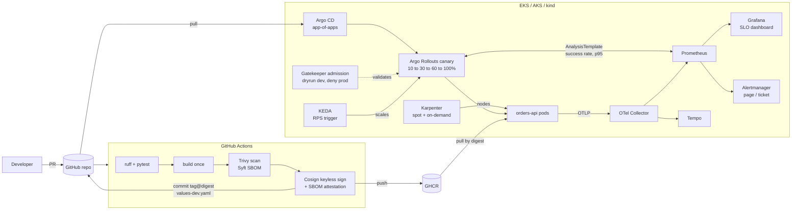

# cloud-platform-blueprint

[](https://github.com/Kmvarma12133/cloud-platform-blueprint/actions/workflows/app-ci.yml)
[](https://github.com/Kmvarma12133/cloud-platform-blueprint/actions/workflows/terraform.yml)
[](https://github.com/Kmvarma12133/cloud-platform-blueprint/actions/workflows/k8s.yml)

A reference platform I built to show how I would run services on Kubernetes
across AWS and Azure:

- **Infrastructure** in Terraform and Terragrunt, with EKS and AKS.
- **Delivery** through Argo CD GitOps, with progressive delivery by Argo Rollouts
  canaries that a Prometheus SLO analysis can abort automatically.
- **Admission policy** in tested Rego, enforced by Gatekeeper.
- **SLO alerting** with multi-window burn rates.
- **A signed supply chain:** image scan, SBOM, keyless Cosign signing, and a
  verified promotion to prod.
- **FinOps controls:** Karpenter spot capacity, NodePool limits, a single NAT in
  dev, and Kubecost.

It is a working blueprint, not a production system at any company. Everything
except the cloud apply runs locally: `make local-up` brings the whole GitOps
flow up on kind, and `make demo-rollback` shows a bad release being stopped by
the platform.

## Architecture



`docs/architecture.md` covers the network layout, every identity flow (GitHub
OIDC, EKS Pod Identity, Azure workload identity) and the dev-to-prod
promotion in detail.

## What this demonstrates

| Skill | Where to look |
|---|---|
| Multi-cloud IaC with secure defaults (KMS everywhere, private EKS endpoint, Entra ID-only AKS, checkov-clean) | [`infra/modules`](infra/modules) |
| DRY environments, account guardrails, dependency mocks | [`infra/live`](infra/live), [ADR 0002](docs/adr/0002-terragrunt-for-environment-dry.md) |
| State backend bootstrap (S3-native locking, TLS-only, versioned) | [`infra/bootstrap`](infra/bootstrap) |
| GitOps: app-of-apps, sync waves, ApplicationSet, per-cluster overlays, manual prod sync | [`platform/gitops`](platform/gitops), [ADR 0001](docs/adr/0001-argocd-gitops-over-push-deploys.md) |
| Progressive delivery measured on canary pods only | [`platform/charts/orders-api`](platform/charts/orders-api), [ADR 0003](docs/adr/0003-argo-rollouts-canary-with-analysis.md) |
| Hardened workloads: non-root, read-only rootfs, seccomp, NetworkPolicy, PDB, zone spread | [`platform/charts/orders-api/templates`](platform/charts/orders-api/templates) |
| Policy as code with unit tests and generated Gatekeeper templates | [`platform/policies`](platform/policies), [ADR 0006](docs/adr/0006-gatekeeper-vs-kyverno.md) |
| SLOs, multi-window burn-rate alerts with promtool tests, page vs ticket routing | [`platform/observability`](platform/observability) |
| Autoscaling: Karpenter nodes, KEDA pods | [`platform/karpenter`](platform/karpenter), [ADR 0004](docs/adr/0004-karpenter-over-cluster-autoscaler.md) |
| Workload identity without static credentials | [`infra/modules/aws-eks`](infra/modules/aws-eks), [ADR 0005](docs/adr/0005-eks-pod-identity-vs-irsa.md) |
| Supply chain: SHA-pinned actions, scan gate, SBOM, keyless signing, verified promotion | [`.github/workflows`](.github/workflows), [ADR 0007](docs/adr/0007-keyless-cosign-signing.md) |
| Operability: runbooks linked from every alert | [`docs/runbooks`](docs/runbooks) |

## Repository layout

```text
app/                         orders-api (FastAPI): RED metrics, JSON logs, OTel tracing
infra/
  bootstrap/                 S3 state bucket and KMS key (local state, applied once)
  modules/aws-vpc|aws-eks|azure-aks
  live/                      Terragrunt: root.hcl, _envcommon/, aws/{dev,prod}, azure/dev
platform/
  charts/orders-api/         Rollout, AnalysisTemplate, ScaledObject, NetworkPolicy, ...
  gitops/
    bootstrap/               Argo CD install (pinned kustomization) and the root app
    apps/                    shared add-ons + orders-api ApplicationSet
    aws/                     Karpenter (AWS only)
    clusters/                eks-dev, eks-prod, aks-dev, local, local-lite
  policies/                  rego/ (source + tests), gatekeeper/ (generated templates, constraints)
  observability/             SLO rules + tests, dashboard, collector/Tempo/Prometheus values
  karpenter/ gateway/ secrets/
scripts/                     local demo, validation and generation scripts
docs/                        architecture, ADRs, runbooks
```

## Quick start

Requirements: Docker (with about 4 GB of memory or more), kind, kubectl and
git. The local demo needs no Helm and no cloud account.

```bash
make local-up       # about 10 minutes the first time
make demo-canary    # a healthy version promoted step by step
make demo-rollback  # a broken version, aborted by the analysis
make demo-reset     # back to a clean state
make local-down
```

`local-up` creates a three-node kind cluster, builds the images, installs Argo
CD and applies one root Application. Argo CD installs everything else from
Git, in sync-wave order. On Docker VMs under about 7 GB it picks the
`local-lite` profile, which leaves out tracing, Alertmanager, External Secrets
and the gateway. Set `LOCAL_PROFILE=local` to force the full set, or
`LOCAL_GIT=1` to serve your current commit from inside the cluster instead of
GitHub.

The validation targets run offline, and CI runs the same checks:

```bash
make lint test tf-validate k8s-validate policy-test
```

Tool versions used: Terraform 1.16, Terragrunt 1.1, tflint 0.64,
terraform-docs 0.24, checkov 3.3, Helm 4.3, kubeconform 0.8, OPA 1.21,
promtool 3.15 and Python 3.12.

## Demo walkthrough

DEMO_OUTPUT_PLACEHOLDER

## Design decisions

| ADR | Decision |
|---|---|
| [0001](docs/adr/0001-argocd-gitops-over-push-deploys.md) | Argo CD GitOps instead of push-based deploys |
| [0002](docs/adr/0002-terragrunt-for-environment-dry.md) | Terragrunt to keep environments DRY |
| [0003](docs/adr/0003-argo-rollouts-canary-with-analysis.md) | Argo Rollouts canary with Prometheus analysis |
| [0004](docs/adr/0004-karpenter-over-cluster-autoscaler.md) | Karpenter instead of Cluster Autoscaler |
| [0005](docs/adr/0005-eks-pod-identity-vs-irsa.md) | EKS Pod Identity by default, IRSA where it fits |
| [0006](docs/adr/0006-gatekeeper-vs-kyverno.md) | Gatekeeper with tested Rego, rather than Kyverno |
| [0007](docs/adr/0007-keyless-cosign-signing.md) | Keyless Cosign signing and SBOM attestation |
| [0008](docs/adr/0008-envoy-gateway-replaces-ingress-nginx.md) | Envoy Gateway instead of the retired ingress-nginx |

## Cost notes

These are rough monthly figures from eu-west-1 list prices. They exclude data
transfer, and the workload node counts are illustrative.

| Item | dev | prod |
|---|---|---|
| EKS control plane | $73 | $73 |
| System node group (m6i.large, on-demand) | 2 × ≈ $78 = $156 | 3 × ≈ $78 = $234 |
| Workload nodes via Karpenter (mostly spot) | ≈ $60 | ≈ $400 |
| NAT gateways (hourly, before data processing) | 1 × ≈ $35 | 3 × ≈ $105 |
| CloudWatch logs (control plane, flow logs) | ≈ $15 (30-day retention) | ≈ $50 (1-year retention) |
| EBS, KMS, load balancer | ≈ $25 | ≈ $70 |
| **Roughly** | **≈ $365** | **≈ $930** |

The FinOps levers used:

- **Spot via Karpenter.** The NodePool allows spot and on-demand across c, m and
  r instance families. Spot is typically 60–70% cheaper, consolidation repacks
  under-used nodes, and the NodePool `limits` cap spend per environment.
- **A single NAT gateway in dev.** This saves about $70 a month in hourly
  charges. Prod keeps one per AZ for resilience.
- **An S3 gateway endpoint.** Image layers and artifacts bypass NAT data
  processing, which is $0.048 per GB.
- **KEDA scaling on request rate**, so idle environments shrink to their floor
  of two replicas.
- **Kubecost**, which allocates spend to namespaces and the `owner` label (the
  label Gatekeeper requires) for showback.
- **Retention as a variable.** Logs are kept 30 days in dev and a year in prod.

Further savings not taken here: Graviton (arm64) nodes, which need a
multi-arch image; Savings Plans for the always-on system nodes; and scheduled
scale-down of dev outside working hours.

## Production hardening not covered

These are deliberately out of scope, and are what I'd do next:

- **Multi-region disaster recovery.** Everything here is single-region. That
  needs a second region per environment, replicated state and secrets, and DNS
  failover.
- **Backups with Velero.** Persistent volumes (Prometheus, Tempo) and cluster
  objects would be backed up to object storage, with restore drills.
  Application data would live in a managed database with its own backups.
- **Service mesh mTLS.** Pod-to-pod traffic inside the cluster is not encrypted
  or mutually authenticated. A mesh (Istio ambient, Linkerd or Cilium) would
  add that, plus L7 authorization.
- **Admission-time signature verification.** Signatures are verified at
  promotion. Enforcing them at admission (Sigstore policy-controller, Kyverno
  `verifyImages` or Ratify) would also block images that bypass the pipeline.
- **The AWS Load Balancer Controller** for an NLB in front of Envoy Gateway,
  with WAF and Shield on the public edge.
- **Argo CD with SSO, RBAC and HA**, managing its own configuration from Git.
- **A private AKS API server** reached through a VPN or Bastion.
- **Remaining add-on identities.** cert-manager DNS-01 through Pod Identity, and
  Karpenter-equivalent Node Auto Provisioning on AKS.

## License

[MIT](LICENSE) © 2026 Manideep Karukuri
