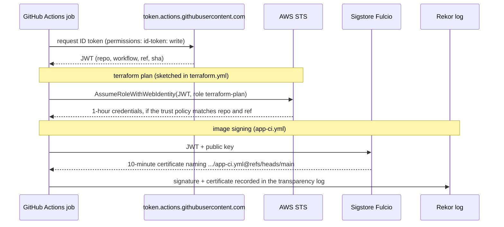
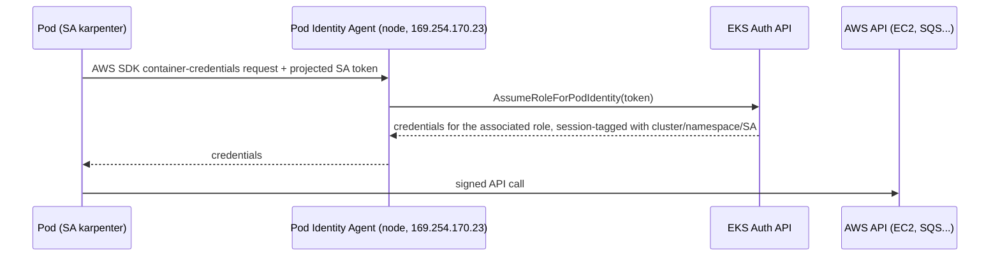
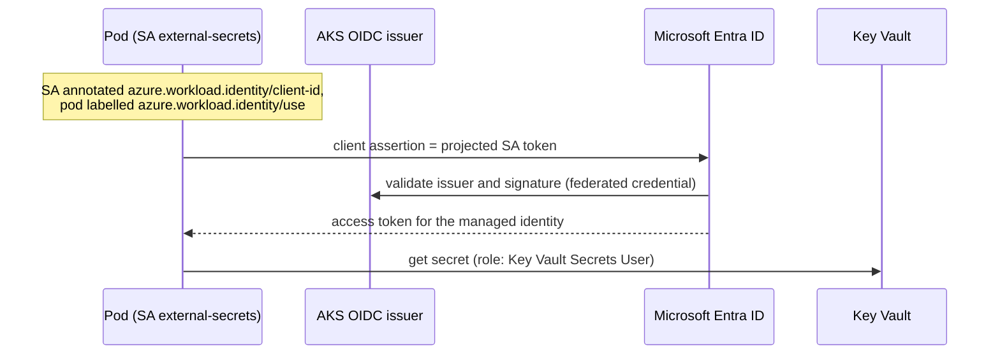

# Architecture

This document covers three things that cut across the repo: how the networks
are laid out, how every component proves who it is without stored
credentials, and how a change moves from a pull request to prod.

## Network layout

Every environment gets its own non-overlapping range, so any two of them can
be peered or connected through a transit gateway later without renumbering.

### AWS (`infra/modules/aws-vpc`)

Each VPC is a /16 carved into /20s with `cidrsubnet(cidr, 4, n)`, across three
pinned availability zones:

| Tier | Purpose | Route to internet | dev (`10.10.0.0/16`) | prod (`10.20.0.0/16`) |
|---|---|---|---|---|
| public (n = 0–2) | Internet-facing load balancers, NAT gateways | IGW, in and out | `10.10.0.0/20`, `10.10.16.0/20`, `10.10.32.0/20` | `10.20.0.0/20`, `10.20.16.0/20`, `10.20.32.0/20` |
| private (n = 4–6) | Nodes and pods (the VPC CNI gives pods VPC addresses) | NAT, outbound only | `10.10.64.0/20`, `10.10.80.0/20`, `10.10.96.0/20` | `10.20.64.0/20`, `10.20.80.0/20`, `10.20.96.0/20` |
| intra (n = 8–10) | EKS control-plane ENIs | none | `10.10.128.0/20`, `10.10.144.0/20`, `10.10.160.0/20` | `10.20.128.0/20`, `10.20.144.0/20`, `10.20.160.0/20` |
| spare | Room for a fourth AZ or new tiers | n/a | `10.10.48.0/20`, `.112.0/20`, `.176.0/20`, `10.10.192.0/18` | same pattern |

Other details:

- **Services.** EKS assigns `172.20.0.0/16` to Services when the VPC is in
  `10.0.0.0/8`.
- **NAT.** Dev uses one NAT gateway; prod uses one per AZ.
- **S3.** A gateway endpoint on the private route tables keeps image-layer and
  artifact traffic off NAT.
- **Pod density.** A /20 per AZ gives about 4,000 addresses for nodes and pods.
  If pod density grows past that, enable VPC CNI prefix delegation or add a
  secondary CIDR for pods.

### Azure (`infra/modules/azure-aks`)

| Range | Purpose |
|---|---|
| `10.30.0.0/16` | Cluster VNet (dev) |
| `10.30.0.0/22` | Node subnet. Only nodes take VNet addresses. |
| `192.168.0.0/16` | Pod overlay (Azure CNI Overlay). Never routed outside the cluster. |
| `172.16.0.0/16` | Services; CoreDNS at `172.16.0.10` |

### Local (kind)

kind's defaults: pods `10.244.0.0/16`, services `10.96.0.0/16`. The two
workers carry `topology.kubernetes.io/zone` labels `zone-a` and `zone-b`, so
the chart's zone spread has something to spread across.

### Traffic path in a cluster

```text
client -> cloud load balancer -> Envoy (Gateway "public", envoy-gateway-system)
       -> HTTPRoute (orders-<env>) -> Service orders-api -> stable + canary pods
```

The orders-api NetworkPolicy admits traffic only from `envoy-gateway-system`
(requests) and `monitoring` (scrapes). On kind it also admits the `load-test`
namespace.

## Identity flows

No component in this platform holds a long-lived cloud credential.

### GitHub Actions to AWS and Sigstore (OIDC)



The terraform-plan role's trust policy only accepts tokens whose `sub`
matches this repository, so a fork can't assume it. The signing certificate's
identity is what `promote-prod.yml` checks with `cosign verify`.

### Pods to AWS (EKS Pod Identity)



Associations live in Terraform (`aws_eks_pod_identity_association`):

- `karpenter/karpenter` → the Karpenter controller role;
- `external-secrets/external-secrets` → a role that can read Secrets Manager
  entries under `cpb/` only.

The EBS CSI driver uses IRSA instead (see ADR 0005). On Karpenter nodes, IMDS
has a hop limit of 1, so pods can't fall back to the node's role.

### Pods to Azure (workload identity)



### People to clusters

| Cluster | How access works |
|---|---|
| **EKS** | Authentication mode `API`. Admins are IAM roles listed in `admin_role_arns`, usually an SSO permission set's role, mapped through access entries to `AmazonEKSClusterAdminPolicy`. There is no `aws-auth` ConfigMap. The cluster creator gets no implicit admin. |
| **AKS** | Entra ID groups in `admin_group_object_ids`, with Azure RBAC. Local accounts are disabled, so there's no static admin kubeconfig to leak. |
| **Argo CD** | The initial admin password is for bootstrap only. In real use, configure SSO in `argocd-cm` and RBAC in `argocd-rbac-cm`. |

## Promotion flow: dev to prod

```mermaid
flowchart LR
    PR[Pull request] -->|app-ci: ruff, pytest,<br/>build, Trivy, SBOM| M[Merge to main]
    M -->|app-ci publish| P[Push to GHCR<br/>cosign sign + attest SBOM]
    P -->|app-ci promote-dev| D[Commit tag@digest<br/>to values-dev.yaml]
    D -->|Argo CD auto-sync| C1{Canary in dev<br/>10 to 30 to 60 to 100%}
    C1 -->|analysis fails| A1[Aborted; stable keeps serving]
    C1 -->|analysis passes| OK1[dev on new version]
    OK1 -->|engineer runs promote-prod<br/>with the commit SHA| G[production environment<br/>approval]
    G --> V[Verify: ran in dev,<br/>signature from app-ci@main,<br/>SBOM attestation]
    V --> PR2[PR pins values-prod.yaml<br/>to tag@digest]
    PR2 -->|review + merge| O[orders-api-prod OutOfSync]
    O -->|person presses Sync| C2{Canary in prod<br/>6 measurements per step}
    C2 -->|passes| OK2[prod on new version]
    C2 -->|fails| A2[Aborted; revert the PR]
```



The gates, in order:

1. **Before merge.** Tests, lint, and an image scan that fails on fixable
   CRITICAL or HIGH vulnerabilities.
2. **Dev.** Each canary step is gated by Prometheus analysis.
3. **Into prod.** A human approves the `production` environment, and the image
   must already have run in dev and carry a valid signature and SBOM
   attestation from this repo's `main`.
4. **Prod changes.** Code review of the promotion PR, then a manual sync, then
   the canary analysis again with more samples per step. In prod the
   Gatekeeper constraints switch from `dryrun` to `deny`.

### Why tag@digest

CI writes `"<sha>@sha256:<digest>"` into the values files. The tag keeps the
change readable in a diff. The digest makes the kubelet pull exactly the bytes
that were scanned, signed and verified, even if someone later pushes a
different image under the same tag.
